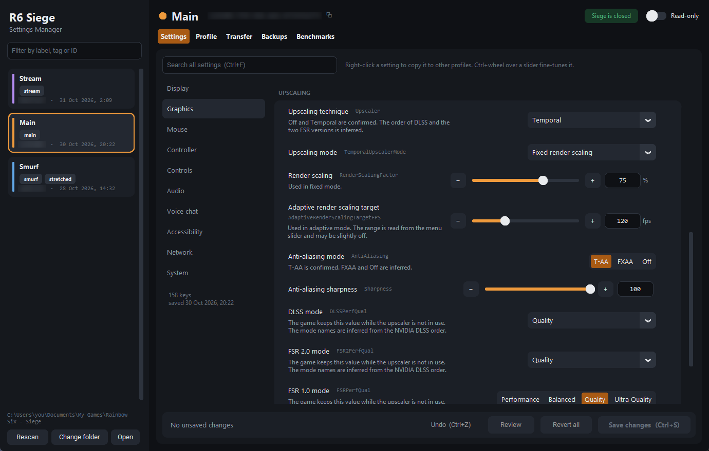
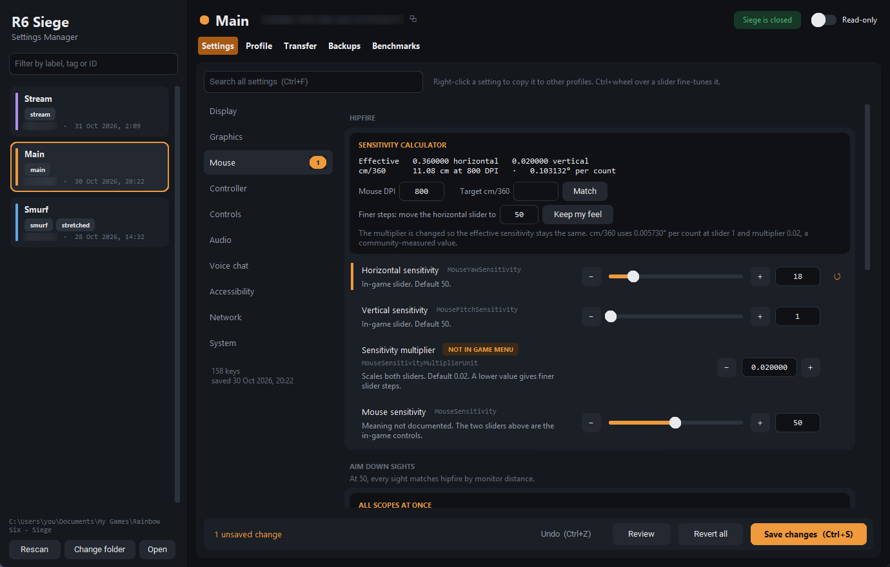
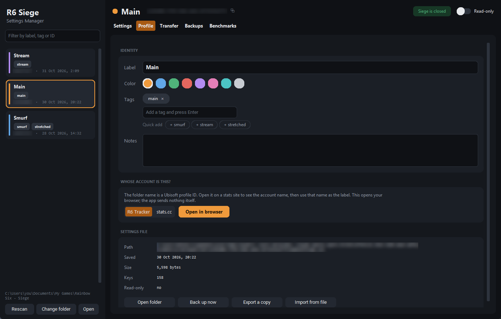
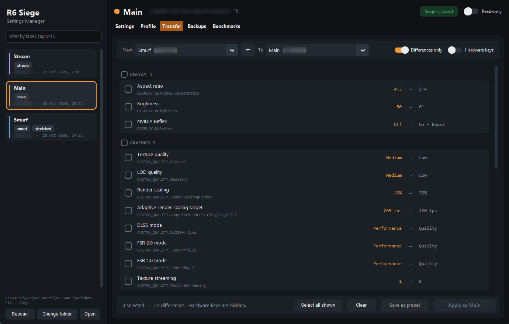
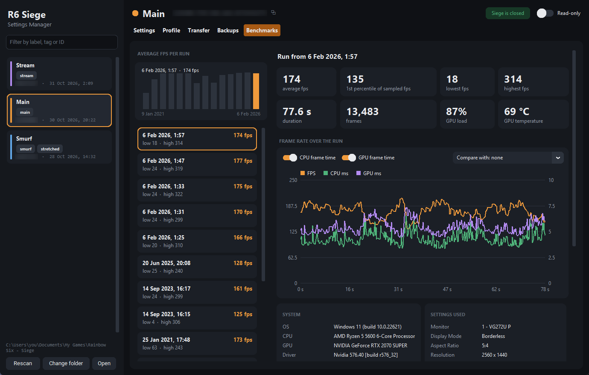

# R6 Siege Settings Manager

A Windows desktop app for Rainbow Six Siege settings files. Siege keeps one `GameSettings.ini` per Ubisoft profile in `Documents\My Games\Rainbow Six - Siege\<profile ID>\`. The app shows every profile in one place, gives each one a label, and lets you edit, compare and copy settings between them.

Download the exe from [Releases](https://github.com/gerxd/r6-settings-manager/releases), or run the script with [uv](https://docs.astral.sh/uv/):

```bash
uv run r6_siege_settings_manager.py
```

## Settings

Settings are grouped like the game menu, with a control for each kind of value. Values that the game stores as an index, such as render scaling and sharpness, are shown in the game's own units.



Keys that the game menu does not offer, such as the sensitivity multiplier, are marked. The Mouse page has a sensitivity calculator that shows cm/360 for your DPI and can change the multiplier without changing your feel.



## Profiles and transfer

Give each profile ID a label, a color and tags. To find out which account a profile ID belongs to, open it on R6 Tracker or stats.cc.



Copy settings from another profile, a preset, a backup or an `.ini` file. You pick each key. Hardware keys are hidden by default.



## Benchmarks

The Benchmarks tab reads the reports of the game's built-in benchmark, with frame rate, CPU and GPU frame times, and a comparison between runs.



## Safety

- The app backs up the file before every save, and you can restore any backup.
- A read-only lock stops the game from overwriting the file.
- Saving is blocked while Siege runs, because the game rewrites the file when it exits.

Labels, presets and backups are stored in `%APPDATA%\R6SiegeSettingsManager`.

## Notes

Ubisoft does not document the value encodings. Aspect ratio, render scaling and sharpness are checked against the game menu. The order of the DLSS and FSR options is inferred, and the app says so where it applies.

To build the exe:

```bash
uv run --no-project --with pyinstaller --with customtkinter --with numpy pyinstaller --noconfirm --onefile --windowed --name "R6 Siege Settings Manager" --collect-data customtkinter r6_siege_settings_manager.py
```
